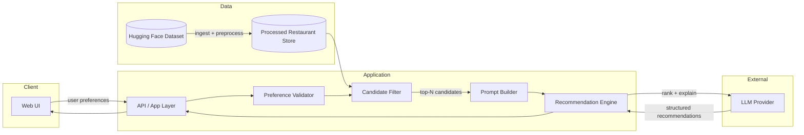
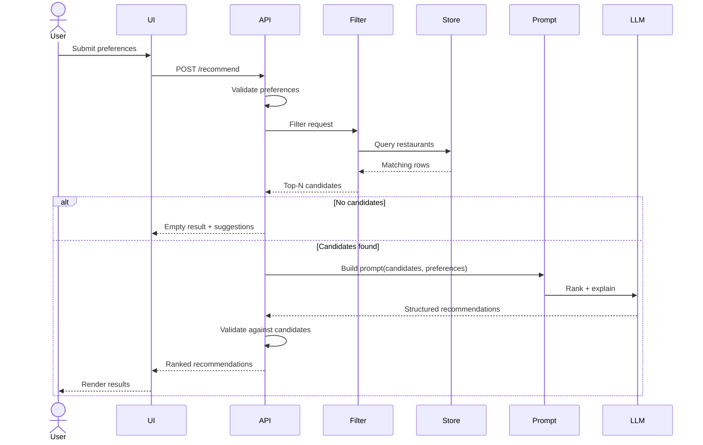

# Architecture

## AI-Powered Restaurant Recommendation System (Zomato Use Case)

This document defines the detailed architecture for the project described in [`problemStatement.md`](./problemStatement.md).

---

## 1. Goals

| Goal | Architectural implication |
|---|---|
| Personalized restaurant suggestions | Hybrid pipeline: deterministic filtering + LLM ranking/explanation |
| Real-world restaurant data | One-time/batch ingestion from Hugging Face into a local structured store |
| Clear, useful output | Structured recommendation schema rendered by a UI layer |
| Maintainable LLM usage | Prompt templates + candidate truncation to control cost/latency |

---

## 2. High-Level Architecture



**Design principle:** Filter first on structured fields (location, budget, cuisine, rating), then ask the LLM only to rank and explain a short candidate list. This keeps answers grounded in data and reduces hallucination risk.

---

## 3. Layered View

| Layer | Responsibility |
|---|---|
| **Presentation** | Collect preferences; display ranked restaurants and AI explanations |
| **Application / API** | Orchestrate request lifecycle; validate input; return response DTO |
| **Domain services** | Filtering, prompt construction, recommendation parsing |
| **Data** | Dataset ingestion, cleaning, field normalization, local persistence/cache |
| **External AI** | LLM call for ranking, explanations, optional summary |

---

## 4. Component Architecture

### 4.1 Data Ingestion Service

**Purpose:** Load the Zomato dataset and produce a clean, queryable restaurant catalog.

**Source:** [ManikaSaini/zomato-restaurant-recommendation](https://huggingface.co/datasets/ManikaSaini/zomato-restaurant-recommendation)

**Responsibilities:**

- Download / load dataset rows
- Select and rename relevant columns (name, location, cuisine, cost, rating, etc.)
- Normalize values:
  - Location casing / city aliases
  - Cuisine lists (split multi-cuisine strings)
  - Cost → budget bucket (`low` / `medium` / `high`)
  - Rating → float; drop or flag invalid values
- Persist processed data (CSV / Parquet / SQLite / in-memory DataFrame for MVP)
- Expose a read API used by the Candidate Filter

**Outputs:** `RestaurantRecord[]` (see Data Model)

---

### 4.2 Preference Collector (UI + Validator)

**Purpose:** Capture and validate user intent before querying data.

**Inputs:**

| Field | Type | Notes |
|---|---|---|
| `location` | string | Required (e.g. Bangalore) |
| `budget` | enum | `low` \| `medium` \| `high` |
| `cuisine` | string | Optional/required depending on UX |
| `min_rating` | number | e.g. 0–5 |
| `additional_preferences` | string | Free text (family-friendly, quick service, etc.) |

**Validation rules:**

- Reject empty location
- Clamp / validate rating range
- Normalize cuisine and location for matching
- Treat free-text preferences as LLM-only signals (not hard filters unless explicitly mapped)

---

### 4.3 Candidate Filter (Integration Layer — deterministic)

**Purpose:** Narrow the full catalog to a relevant shortlist before LLM invocation.

**Filter pipeline (ordered):**

1. Location match (exact / contains / city field)
2. Cuisine match (token / substring against cuisine list)
3. Budget match using mapped cost buckets
4. Rating ≥ `min_rating`
5. Sort by rating (and optionally cost proximity)
6. Truncate to top **N** candidates (recommended: 10–25)

**Why this exists:** LLMs should not scan the full dataset. Filtering provides relevance, latency control, and factual grounding.

---

### 4.4 Prompt Builder

**Purpose:** Convert filtered restaurants + user preferences into a controlled LLM prompt.

**Prompt contents:**

- System role: restaurant recommendation assistant; must use only provided candidates
- User preferences (structured)
- Candidate restaurant JSON/table
- Output contract: ranked list with explanations (and optional summary)
- Constraints: no invented restaurants; explain fit against preferences

**Prompt strategy:**

- Prefer structured output (JSON) for reliable UI rendering
- Include only fields needed for ranking (name, cuisine, rating, cost, location, short metadata)
- Cap candidate count and explanation length

---

### 4.5 Recommendation Engine

**Purpose:** Call the LLM, parse the response, and produce UI-ready recommendations.

**Steps:**

1. Send prompt to LLM provider
2. Parse structured response
3. Validate that returned restaurant names exist in the candidate set
4. Attach source fields (rating, cost, cuisine) from store for display consistency
5. Optionally generate a short overall summary
6. Return final recommendation payload to the API/UI

**Failure handling:**

- If LLM response is malformed → retry once with stricter schema instruction, or fall back to deterministic top-N by rating
- If no candidates after filtering → return empty-state guidance (relax filters)

---

### 4.6 Presentation Layer

**Purpose:** User-facing experience for input and results.

**Screens / sections:**

1. Preference form
2. Loading / generating recommendations state
3. Results list:
   - Restaurant Name
   - Cuisine
   - Rating
   - Estimated Cost
   - AI-generated explanation
4. Optional overall summary

---

## 5. End-to-End Request Flow



---

## 6. Data Model

### 6.1 RestaurantRecord (processed store)

```json
{
  "id": "string",
  "name": "string",
  "location": "string",
  "cuisines": ["string"],
  "cost_for_two": 800,
  "budget_band": "medium",
  "rating": 4.2,
  "votes": 1200,
  "metadata": {}
}
```

### 6.2 UserPreferences

```json
{
  "location": "Bangalore",
  "budget": "medium",
  "cuisine": "Italian",
  "min_rating": 4.0,
  "additional_preferences": "family-friendly, quick service"
}
```

### 6.3 RecommendationResponse

```json
{
  "summary": "Optional short overview of the shortlist",
  "recommendations": [
    {
      "rank": 1,
      "name": "Restaurant Name",
      "cuisine": "Italian",
      "rating": 4.5,
      "estimated_cost": "₹800 for two",
      "explanation": "Why this fits the user's preferences"
    }
  ],
  "meta": {
    "candidates_considered": 15,
    "filters_applied": ["location", "cuisine", "budget", "min_rating"]
  }
}
```

---

## 7. Suggested Module / Folder Structure

```text
Zomato/
├── Docs/
│   ├── problemStatement.md
│   └── architecture.md
├── data/
│   ├── raw/                  # optional local cache of HF extract
│   └── processed/            # cleaned restaurant catalog
├── src/
│   ├── ingestion/
│   │   └── load_dataset.py
│   ├── models/
│   │   └── schemas.py        # Restaurant, Preferences, Recommendation
│   ├── services/
│   │   ├── filter.py         # deterministic candidate selection
│   │   ├── prompt_builder.py
│   │   └── recommender.py    # LLM orchestration + parsing
│   ├── api/                  # FastAPI / Flask routes (if backend)
│   │   └── routes.py
│   └── ui/                   # Streamlit / Gradio / web frontend
│       └── app.py
├── prompts/
│   └── recommend_system.txt
├── .env.example              # LLM API key placeholders
└── requirements.txt
```

> Exact framework choices can vary; the architecture above is framework-agnostic. A practical MVP stack is **Python + Pandas + Streamlit/Gradio + OpenAI-compatible LLM API**.

---

## 8. Technology Blueprint (MVP)

| Concern | Suggested choice | Rationale |
|---|---|---|
| Language | Python | Strong data + LLM ecosystem |
| Dataset access | Hugging Face `datasets` | Direct source integration |
| Processing | Pandas | Fast filtering/normalization |
| App UI | Streamlit or Gradio | Fast preference form + results UI |
| API (optional) | FastAPI | Clean separation if UI and logic split |
| LLM | OpenAI / Gemini / compatible chat model | Ranking + natural-language explanations |
| Config | `.env` + settings module | Keep secrets out of code |
| Persistence | Local Parquet/CSV or SQLite | Simple for MVP; upgrade later if needed |

---

## 9. LLM Integration Design

### 9.1 Responsibilities of the LLM

- Rank filtered candidates against preferences (including free-text nuances)
- Write human-like explanations
- Optionally summarize the shortlist

### 9.2 Responsibilities NOT given to the LLM

- Scanning the full dataset
- Inventing restaurants not in the candidate list
- Acting as the sole source of rating/cost facts (UI should prefer store values)

### 9.3 Grounding rules

1. Candidate set is the only allowed recommendation universe
2. Post-parse name matching against candidates
3. Display numeric facts from the processed store when available

---

## 10. API Contract (optional backend)

### `POST /recommend`

**Request**

```json
{
  "location": "Bangalore",
  "budget": "medium",
  "cuisine": "Italian",
  "min_rating": 4.0,
  "additional_preferences": "family-friendly"
}
```

**Response:** `RecommendationResponse` (see §6.3)

**Error cases:**

| Code | Meaning |
|---|---|
| 400 | Invalid preferences |
| 404 | No restaurants match filters |
| 502 | LLM provider failure after fallback attempt |
| 500 | Unexpected server error |

---

## 11. Non-Functional Requirements

| Area | Approach |
|---|---|
| Latency | Preprocess dataset once; filter before LLM; limit candidates |
| Cost control | Short prompts; truncated fields; avoid full-table dumps |
| Reliability | Deterministic fallback ranking if LLM fails |
| Observability | Log filter counts, candidate size, LLM latency, parse failures |
| Security | API keys in env vars; no secrets in repo |
| UX clarity | Empty states, loading states, explanation visibility |

---

## 12. Build Phases

1. **Ingestion** — load HF dataset, clean fields, write processed catalog  
2. **Filtering** — implement preference → candidate shortlist  
3. **LLM layer** — prompt template + ranking/explanation parsing  
4. **UI** — preference form + recommendation cards  
5. **Hardening** — validation, fallbacks, logging, empty states  

---

## 13. Architecture Summary

The system is a **hybrid recommender**:

- **Structured retrieval** finds feasible restaurants from real Zomato data  
- **LLM reasoning** personalizes ranking and generates explanations  
- **UI** presents a clear shortlist with name, cuisine, rating, cost, and why it fits  

This keeps the product grounded, explainable, and practical to implement as an end-to-end application.
