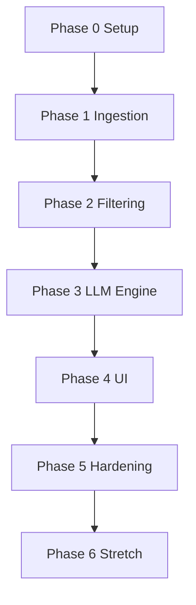

# Implementation Plan

## AI-Powered Restaurant Recommendation System (Zomato Use Case)

Phase-wise plan for building the project defined in [`problemStatement.md`](./problemStatement.md) and [`architecture.md`](./architecture.md).

**MVP stack:** Python · Pandas · Hugging Face `datasets` · Streamlit (or Gradio) · OpenAI-compatible LLM API

---

## Overview

| Phase | Focus | Outcome |
|---|---|---|
| 0 | Project setup | Runnable repo skeleton + config |
| 1 | Data ingestion | Clean processed restaurant catalog |
| 2 | Preferences + filtering | Deterministic candidate shortlist |
| 3 | LLM recommendation engine | Ranked list with explanations |
| 4 | UI | End-to-end user-facing app |
| 5 | Hardening | Fallbacks, validation, polish |
| 6 | Stretch (optional) | API split, caching, richer UX |

Each phase has **goals**, **tasks**, **deliverables**, and **exit criteria**. Do not start the next phase until exit criteria pass.

---

## Phase 0 — Project Setup

**Goal:** Establish a clean, runnable project foundation.

### Tasks

1. Create folder structure from architecture (`src/`, `data/`, `prompts/`, `Docs/`)
2. Initialize Python environment (`venv` / `uv` / `conda`)
3. Add `requirements.txt` with baseline deps:
   - `datasets`, `pandas`, `python-dotenv`
   - UI: `streamlit` (or `gradio`)
   - LLM client (provider-specific)
4. Add `.env.example` with placeholders (`LLM_API_KEY`, `LLM_MODEL`, etc.)
5. Add `.gitignore` (`.env`, `data/raw/`, `__pycache__/`, `.venv/`)
6. Add a minimal `README.md` with run instructions (optional but recommended)

### Deliverables

- Repo skeleton matching architecture
- Working virtualenv + installable dependencies
- Env template without secrets

### Exit criteria

- [ ] `pip install -r requirements.txt` succeeds
- [ ] App entrypoint can start (even with a placeholder page)
- [ ] No secrets committed

---

## Phase 1 — Data Ingestion & Preprocessing

**Goal:** Load the Hugging Face Zomato dataset and produce a clean, queryable catalog.

**Dataset:** [ManikaSaini/zomato-restaurant-recommendation](https://huggingface.co/datasets/ManikaSaini/zomato-restaurant-recommendation)

### Tasks

1. Inspect dataset schema and sample rows
2. Implement `src/ingestion/load_dataset.py`:
   - Load from Hugging Face
   - Keep/rename fields: name, location, cuisine, cost, rating (+ useful extras)
3. Normalize data:
   - Location casing / trim
   - Cuisine → list or normalized string
   - Cost → numeric + `budget_band` (`low` / `medium` / `high`)
   - Rating → float; drop invalid rows
4. Write processed output to `data/processed/` (CSV or Parquet)
5. Add a small sanity script/notebook check:
   - Row counts before/after cleaning
   - Value distributions for city, cuisine, budget, rating

### Deliverables

- Ingestion module
- `data/processed/restaurants.*`
- Documented column meanings (brief notes in code or Docs)

### Exit criteria

- [ ] Processed file loads quickly into Pandas
- [ ] Required fields present and typed correctly
- [ ] Budget bands and ratings are usable for filtering
- [ ] Can query a known city (e.g. Bangalore) and get non-empty rows

---

## Phase 2 — Preference Model & Candidate Filtering

**Goal:** Convert user preferences into a deterministic shortlist of restaurants.

### Tasks

1. Define schemas in `src/models/schemas.py`:
   - `UserPreferences`
   - `RestaurantRecord`
2. Implement preference validation:
   - Required location
   - Budget enum
   - Rating range clamp
   - Cuisine / free-text normalization
3. Implement `src/services/filter.py`:
   1. Location match
   2. Cuisine match
   3. Budget band match
   4. `rating >= min_rating`
   5. Sort (rating desc)
   6. Truncate to top **N** (start with 15–20)
4. Add unit-style checks for filter edge cases:
   - No matches
   - Partial matches
   - Overly strict filters

### Deliverables

- Preference schema + validator
- Candidate filter service
- Sample filtered output for a fixed preference set

### Exit criteria

- [ ] Given sample preferences, filter returns a stable shortlist
- [ ] Empty-result case is detectable and message-ready
- [ ] Candidate count is capped (no full-dataset dumps)

---

## Phase 3 — LLM Prompting & Recommendation Engine

**Goal:** Rank filtered candidates and generate human-like explanations via LLM.

### Tasks

1. Create prompt templates in `prompts/`:
   - System instructions (use only provided candidates)
   - User message format (preferences + candidate JSON)
   - Required JSON output schema
2. Implement `src/services/prompt_builder.py`
3. Implement `src/services/recommender.py`:
   - Call LLM
   - Parse structured response
   - Validate restaurant names against candidate set
   - Merge store facts (rating/cost/cuisine) for display consistency
   - Optional shortlist summary
4. Add deterministic fallback:
   - If LLM fails/parses badly → return top candidates by rating with a generic explanation
5. Log basic metrics: candidate count, latency, parse success/failure

### Deliverables

- Prompt templates
- Recommender service returning `RecommendationResponse`
- Fallback path

### Exit criteria

- [ ] LLM returns ranked recommendations for a valid shortlist
- [ ] Explanations reference user preferences
- [ ] Invented restaurant names are rejected / filtered out
- [ ] Fallback works when API key is missing or call fails

---

## Phase 4 — UI (End-to-End MVP)

**Goal:** Ship a usable app where a user submits preferences and sees recommendations.

### Tasks

1. Build preference form:
   - Location
   - Budget (`low` / `medium` / `high`)
   - Cuisine
   - Minimum rating
   - Additional preferences (free text)
2. Wire form → validator → filter → recommender
3. Render results cards/list with:
   - Restaurant Name
   - Cuisine
   - Rating
   - Estimated Cost
   - AI-generated explanation
4. Add UX states:
   - Loading while generating
   - Empty results guidance (“relax filters”)
   - Error message for LLM/config issues
5. Optionally show overall summary above the list

### Deliverables

- `src/ui/app.py` (or equivalent)
- Working local demo flow

### Exit criteria

- [ ] Full happy path works locally with real/processed data + LLM
- [ ] Empty and error states are understandable
- [ ] Output matches problem-statement display fields

---

## Phase 5 — Hardening & Demo Readiness

**Goal:** Make the MVP reliable enough to demo and iterate.

### Tasks

1. Tighten validation and user-facing error messages
2. Ensure `.env` loading and clear “missing API key” guidance
3. Cap prompt size (fields + candidate N) for cost/latency
4. Add lightweight logging for debugging demos
5. Smoke-test 5–8 preference combinations (different cities/cuisines/budgets)
6. Update Docs if implementation choices diverge from architecture
7. Prepare short demo script (inputs → expected narrative)

### Deliverables

- Stable demo build
- Known-good test preference set
- Updated docs (if needed)

### Exit criteria

- [ ] Demo path runs without manual code edits
- [ ] At least one graceful degradation path verified
- [ ] No secrets in repo
- [ ] Problem-statement workflow fully covered end-to-end

---

## Phase 6 — Stretch Enhancements (Optional)

Only after MVP is solid.

| Enhancement | Value |
|---|---|
| FastAPI `POST /recommend` | Separate UI and backend |
| SQLite/Parquet query layer | Faster repeated filtering |
| Cache processed dataset in memory on startup | Lower latency |
| Cuisine autocomplete from catalog | Better UX |
| Multi-city / fuzzy location matching | Fewer empty results |
| Evaluation set for ranking quality | Measure recommendation usefulness |
| Streamlit Cloud / container deploy | Shareable demo |

---

## Dependency Graph

**Critical path:** Ingestion → Filtering → LLM → UI  
UI can begin as a shell in Phase 0/4, but must not block core services.

---

## Suggested Execution Order (Practical)

1. Setup env + folders  
2. Ingest & inspect data  
3. Build filter with print/debug output  
4. Add LLM ranking on top of filter  
5. Wrap in Streamlit form + results  
6. Harden for demo  

---

## Definition of Done (Project MVP)

The project is done when a user can:

1. Enter location, budget, cuisine, min rating, and optional preferences  
2. Get a shortlist derived from the real Hugging Face Zomato dataset  
3. See LLM-ranked restaurants with explanations  
4. View name, cuisine, rating, estimated cost, and why each pick fits  
5. Experience clear empty/error states if filters or LLM fail  

---

## Tracking Checklist

Copy into issues/todos as needed:

- [ ] Phase 0 — Setup  
- [ ] Phase 1 — Ingestion  
- [ ] Phase 2 — Filtering  
- [ ] Phase 3 — LLM engine  
- [ ] Phase 4 — UI  
- [ ] Phase 5 — Hardening  
- [ ] Phase 6 — Stretch (optional)  
